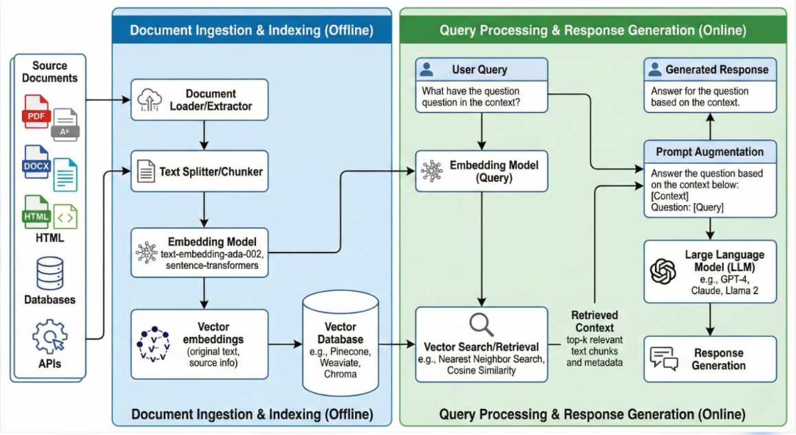

# RAG (Retrieval-Augmented Generation)

## 1. What is RAG?

- RAG optimizes the output generated by the LLM.
- RAG is a technique that enhances the capabilities of an LLM by retrieving information from external sources and sending that information back to the LLM as context before generating the answer.

### Components of RAG

- **Retrieval:** It means retrieving the information from the Knowledge Base.
- **Augmentation:** It means sending that information as context to the LLM.
- **Generation:** It means the LLM generates the response using the context and user question.

---

## 2. LLM Limitations and How RAG Solves Them

- **Knowledge Limitations:** An LLM is trained on a particular dataset. It may not know your company data.

- **Hallucinations:** If the LLM does not have any data related to your question, it may generate its own answer.

- **Updates:** If your company changes its HR policy, you don't want to retrain the entire LLM just to update that information.

> **Note:** RAG does not solve the hallucination problem completely. It depends on your retrieval quality, context quality, and the LLM's ability to use the retrieved information.

---

## 3. RAG Architecture

Mainly, RAG has two pipelines:

### 3.1 Data Ingestion Pipeline

**Steps:**

1. Data Loading
2. Document Parsing
3. Document Cleaning
4. Document Splitting (Chunking)
5. Embedding Generation
6. Storing Vectors in Vector Database

#### 1. Document Parsing (Very Important)

- Extracting meaningful content from different file formats.

#### 2. Document Splitting (Chunking)

- It is the process of splitting large documents into small pieces so retrieval will become efficient.
- You can split the chunks using two fields:
  - `chunk_size`
  - `chunk_overlap`

**Chunk Size:**
- It tells how much data is contained in each chunk. It depends on the splitter.

**Chunk Overlap:**
- Mainly, chunk overlap is used to preserve the meaning between chunks.

**Interview Point:**
- Too little overlap means losing meaning.
- Too much overlap means redundant chunks and increases storage as well.

#### Types of Chunking

- Fixed Size Chunking
- Recursive Splitter Chunking

#### 3. Embedding Generation

- Converting text chunks into numerical vectors using an embedding model.

#### 4. Storing Vectors

- Storing the generated vectors in a Vector Database.

---

### 3.2 Retrieval Pipeline

**Steps:**

1. User Query
2. Query Embedding
3. Similarity Search
4. Context Construction
5. Prompt Construction
6. Output Generation Using LLM

**Retrieval:**

- This process is called Retrieval.
- Retrieval means the process of finding relevant documents or document chunks from the Knowledge Base.

#### Knowledge Base vs Vector Database

- Knowledge Base and Vector Database are not the same.
- A Knowledge Base is the overall collection of knowledge.
- A Vector Database is one technology to store its vectors.

---

## 4. What is Similarity Search?

- Similarity Search is a process of finding vectors that are closest to a given query vector based on similarity or distance.

### Common Similarity Metrics

1. **Cosine Similarity**
   - Measures the angle between two vectors.

2. **Euclidean Distance**
   - Finds out the distance between two points.

3. **Dot Product**
   - Measures the sum of the products of corresponding dimensions of two vectors.

---

## 5. Context Window

- Context Window or Context Size is nothing but the maximum number of tokens a model can process in a single request or input.

**Example:**
- GPT-6 context size: 1,050,000 tokens (as noted in these learning notes).